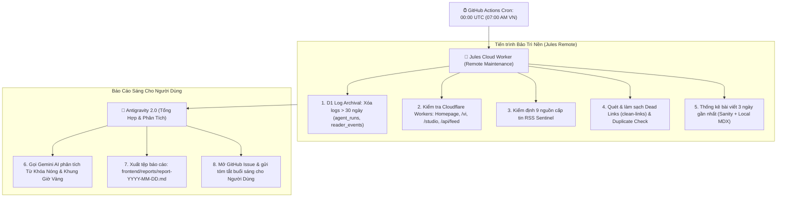

# Antigravity 2.0 Multi-Agent SDLC Protocol

Dự án này áp dụng quy trình phát triển phần mềm chuẩn hóa 6 giai đoạn với đội hình Multi-Agent chuyên biệt:

---

## 1. Phân vai Biệt đội Agent (Squad Roles)

- **Antigravity 2.0 (Tổng chỉ huy & Kiến trúc sư trưởng):**
  - Tiếp nhận yêu cầu từ người dùng, làm rõ yêu cầu (`/grill-me`, `interview-me`).
  - Viết tài liệu đặc tả `implementation_plan.md`, `task.md` và xây dựng Type Contracts / API schemas.
  - Phân công nhiệm vụ cho các agent con và là chốt chặn phê duyệt cuối cùng.
  - **Giám sát & Báo cáo Sáng (Morning Report):** Nhận tín hiệu kiểm tra từ xa từ Jules, kích hoạt phân tích từ khóa AI (Gemini), xuất bản và gửi Báo cáo Vận hành Buổi Sáng (07:00 AM VN) cho Người Dùng.

- **OpenCode CLI (`opencode-frontend` - Chuyên gia Frontend & UI/UX Đỉnh cao):**
  - Đảm nhận toàn bộ mã nguồn Frontend, UI components (React, Next.js, Vue, Vite, Tailwind CSS).
  - Định hình phong cách thiết kế độc bản, hiện đại, mang đẳng cấp quốc tế theo chuẩn **Awwwards & Dribbble**.

- **Jules (`jules-cloud-worker` - Điều phối viên Cloud Async & Bảo trì từ xa):**
  - Chuyên xử lý tác vụ nền đám mây qua Jules MCP.
  - Tự động tạo nhánh và mở Pull Request trên GitHub cho các tác vụ backend, viết integration test suites lớn, hoặc nâng cấp thư viện mà không làm nghẽn máy cục bộ.
  - **Đảm nhiệm tiến trình kiểm tra & bảo trì từ xa (Remote Daily Maintenance):**
    + Đo kiểm độ trễ & tính sẵn sàng của Cloudflare Edge Workers, Sanity Studio, RSS API.
    + Thực thi định kỳ Log Archival trên Cloudflare D1 (xóa bản ghi `agent_runs` và `reader_events` cũ hơn 30 ngày để tối ưu gói Cloudflare Free-tier).
    + Quét liên kết hỏng (dead links) và bài viết trùng lặp.
    + Thống kê số lượng bài đã tạo/đăng thành công 3 ngày gần nhất.

- **CommandCode CLI (`commandcode-ops` - QC/QA & DevOps Gatekeeper):**
  - Chuyên viên thực thi terminal: Chạy test suite thực tế (`npm test`, `pytest`), linter, typecheck. Bắt log lỗi thực tế, không chấp nhận kết quả phỏng đoán.
  - Đóng gói container (Docker), kiểm tra staging và thực thi quy trình Deploy an toàn có cơ chế rollback.

---

## 2. Tiêu chuẩn Frontend & UI/UX Sáng tạo (Awwwards & Dribbble Benchmark)

Mọi sản phẩm giao diện do **OpenCode CLI** thực hiện BẮT BUỘC phải tuân thủ các tiêu chuẩn thẩm mỹ cao cấp:
1. **Tuyệt đối chống rập khuôn (Anti-Generic AI Design):** Không tạo giao diện "AI nhàm chán" với màu tím/xanh nhạt mặc định, bố cục hộp thô kệch hay card nhàm chán.
2. **Nghiên cứu & Áp dụng phong cách Awwwards:**
   - Nghệ thuật typography (Editorial serif kết hợp Modern geometric sans, phân cấp thị giác rõ ràng).
   - Bố cục bứt phá: Bento Grid, bố cục bất đối xứng có chủ đích (asymmetric layouts), không gian thở (whitespace) sang trọng.
   - Hiệu ứng thị giác: Gradient mesh mượt mà, subtle noise/grain texture, dark mode tinh tế có chiều sâu.
3. **Nghiên cứu & Áp dụng phong cách Dribbble:**
   - Micro-interactions sống động: Nút bấm có hiệu ứng từ tính (magnetic button), hover feedback phản hồi tự nhiên, card tilt/parallax nhẹ nhàng.
   - Chuyển động mượt mà (Spring physics animations với Framer Motion hoặc CSS transitions), đạt 60 FPS, không gây lag giao diện.
   - Trạng thái hoàn chỉnh: Có đầy đủ Skeleton loader, Empty state truyền cảm hứng, và Error state tinh tế.
4. **Tiêu chuẩn công thái học & Accessibility:** Chuẩn WCAG 2.1 AA, hiển thị xuất sắc từ mobile đến màn hình siêu rộng (responsive ergonomics).

---

## 3. Quy trình 6 bước chuẩn hóa (SDLC Lifecycle)

1. **Ý tưởng (Ideation):** Không viết code. Phỏng vấn làm rõ mục tiêu, phong cách mỹ thuật và user persona.
2. **Kế hoạch (Planning):** Định nghĩa Type Contracts trước (Interface, Schema). Chờ User phê duyệt `implementation_plan.md`.
3. **Phân công (Delegation):** Phân tách rõ ràng: Frontend $\rightarrow$ OpenCode; Cloud/PR/Backend $\rightarrow$ Jules; Test/Ops $\rightarrow$ CommandCode.
4. **Code (Implementation):** Thực thi trên nhánh Git riêng (`feat/...`), theo phương pháp TDD, commit nhỏ gọn (< 300 dòng).
5. **Audit / QC / QA (Kiểm định đối kháng):** Áp dụng nguyên tắc **Zero Self-Review**. CommandCode chạy test terminal; Subagents `code-reviewer` và `security-auditor` kiểm tra ở Fresh Context.
6. **Triển khai (Deploy):** Bắt buộc vượt qua pre-flight checklist: Test exit code = 0, git tree sạch, file `.env` hợp lệ và có kịch bản rollback dự phòng.

---

## 4. Quy tắc giao tiếp & bảo tồn Context
- Các subagent làm việc độc lập và chỉ gửi **Bản tóm tắt ngắn (Summary-Only Protocol)** về cho Lead Agent: (1) Trạng thái Pass/Fail, (2) Danh sách file thay đổi, (3) Lỗi cụ thể nếu có. Toàn bộ chi tiết lưu vào file `walkthrough.md`.
- Giữ context của Antigravity Lead luôn nhẹ và sắc bén để đưa ra quyết định kiến trúc chính xác.

---

## 5. Quy Trình Bảo Trì & Báo Cáo Buổi Sáng Tự Động (Daily Morning Routine)

Mỗi ngày vào lúc **00:00 UTC (07:00 sáng giờ Việt Nam)**, quy trình bảo trì kép được kích hoạt:

### Các chốt kiểm soát trong báo cáo hàng sáng:
1. **Kiểm tra hạ tầng & độ trễ:** Đảm bảo tất cả HTTP status = 200, latency < 500ms.
2. **Kiểm tra 9 nguồn RSS:** Phát hiện sớm nguồn tin bị chặn hoặc chậm để cảnh báo đội biên tập.
3. **Thống kê số lượng bài 3 ngày gần nhất:** Theo dõi liên tục sản lượng bài viết trên Sanity CMS và kho lưu trữ tĩnh Local MDX.
4. **Cảnh báo thiếu bài (Content Starvation):** Cảnh báo khẩn khi bất kỳ chuyên mục nào có dưới 2 bài mới.
5. **Đề xuất từ khóa AI (Gemini Insights):** 10 từ khóa đắt giá kèm Search Intent và chiến lược khung giờ vàng đăng bài trong ngày.

---

## 6. Đúc kết Bài học & Bộ nhớ Kiến trúc (System Memory & Architecture Lessons)

> [!IMPORTANT]
> **GIAO THỨC BẮT BUỘC ĐỌC (MANDATORY PRE-TASK MEMORY CHECK):**
> Tất cả các Agents (Lead Orchestrator, OpenCode, Jules, CommandCode) BẮT BUỘC phải đọc và ghi nhớ toàn bộ các bài học trong mục này TRƯỚC KHI thực hiện bất kỳ nhiệm vụ nào. Tuyệt đối không để xảy ra sai sót lặp lại.

1. **Quy tắc Bento Grid & Tailwind CSS v4 (Monorepo Class Purging):**
   - Tuyệt đối không dùng chuỗi nội suy động (dynamic template literals như ``lg:col-span-${colSpan}``) trong các package dùng chung (`packages/ui`), vì Tailwind v4 / Rolldown không tự động quét các dynamic tokens từ external libraries khi build ứng dụng con.
   - Bắt buộc dùng Bảng tra cứu tĩnh (Static Lookup Table) kết hợp lớp định danh cứng (`.bento-col-1` đến `.bento-col-12` và `.bento-col-md-X`) được định nghĩa rõ ràng với `@media` và `!important` trong `globals.css` để đảm bảo lưới 12 cột chuẩn xác (8-4, 4-4-4, 3-6-3) trên mọi độ phân giải PC và Tablet.

2. **Quy tắc Thao tác Máy chủ NAS (TerraMaster TOS 6 & Coolify / Docker):**
   - Máy chủ NAS đã nâng cấp lên **TerraMaster TOS 6** (Linux kernel 6.x, nâng cấp bảo mật phân quyền container).
   - Lệnh `scp` sang NAS TerraMaster BẮT BUỘC phải kèm cờ `-O` (`scp -O ...`) vì SSH daemon TOS 6 mặc định hạn chế giao thức SFTP.
   - Phải luôn tạo trước thư mục đích trên NAS (`ssh -T nas "mkdir -p '...'`) trước khi copy các file hoặc route mới, tránh trường hợp tạo nhầm file thường thay vì thư mục.
   - Luôn duy trì giới hạn phần cứng an toàn (`cpus: '1.5'`, `max-old-space-size=1024`) trong cấu hình Docker để tránh kernel OOM-killer.

3. **Quy tắc Quản lý Chuyên mục & Chống Empty State:**
   - Mọi chuyên mục mới (hoặc khi tái định vị chuyên mục) phải đồng bộ đầy đủ 3 thành phần:
     1. File route Next.js (`apps/web/app/(public)/<chuyen-muc>/page.tsx`).
     2. Giao diện nhận diện đặc trưng (Theme Aura, Badges, Widget chuyên biệt trong `category-template.tsx`).
     3. Tối thiểu 1-3 bài viết thực tế đã publish trong Cloudflare D1 database (kèm script seed lưu tại `packages/db/seeds/`).

4. **Quy tắc Độ tương phản & Hai chế độ Sáng / Tối (Theme Switcher WCAG):**
   - Tuyệt đối không hardcode màu nền tối (`bg-slate-900`, `bg-[#07080B]`) hay chữ trắng (`text-white`) mà không kèm biến CSS hoặc selector `[html.light_&]`. Mọi card, nút bấm, và text đều phải đạt chuẩn WCAG AA/AAA trên cả nền sáng (Light Solar) và nền tối (Dark Void).
   - Mọi hoạt ảnh 3D/Canvas (như `Hero3D`) phải tự động nhận diện active theme (`html.light` hoặc `data-theme="light"`) để chuyển đổi màu nền, hạt và lưới tương ứng.

5. **Quy tắc Dữ liệu Thời gian Thực (Live Real-Time Feeds & Ground Truth):**
   - Mọi widget dữ liệu (AI Benchmark, VN30 / Market Tickers, Crypto) BẮT BUỘC kết nối nguồn API thực tế hoặc Cloudflare Worker background cron fetcher lưu trữ vào D1/KV. Tuyệt đối không dùng số liệu tĩnh giả lập không nguồn gốc khi đưa lên production.

6. **Quy tắc Bắt buộc khi Kết nối NotebookLM (MANDATORY NLM GROUND TRUTH AUTO-SYNC):**
   - Khi Người dùng yêu cầu kết nối hoặc tham vấn NotebookLM, AI / Subagents TUYỆT ĐỐI KHÔNG chỉ dừng lại ở việc hỏi đáp qua chat đơn thuần.
   - BẮT BUỘC PHẢI tự động rà soát và kéo toàn bộ tài nguyên nghiên cứu đã tích lũy trong tab Studio của NotebookLM về dự án:
     1. Toàn bộ mã nguồn mẫu (.ts, .py, .sql, .json) do NLM tạo ra $\rightarrow$ lưu về `docs/nlm_ground_truth_code/`.
     2. Toàn bộ tài nguyên đồ họa (.png, spritesheets, portraits, assets) $\rightarrow$ tải về `apps/client/public/assets/`.
     3. Toàn bộ ghi chú nghiên cứu (Notes, Báo cáo tóm tắt, Sơ đồ tư duy) để làm Ground Truth.
   - Bàn giao ngay cho CommandCode (`cmdc`) đối chiếu trực tiếp giữa mã nguồn NLM và codebase hiện tại trước khi triển khai bất kỳ tính năng nào để không bị sai lệch logic hay bỏ sót công sức nghiên cứu đã thống nhất với NLM.

7. **Quy tắc Cấm Hardcode Mock Data & Bắt Buộc Empty State (Zero-Mock Production Protocol):**
   - Nghiêm cấm tuyệt đối việc hardcode số liệu tĩnh, bài viết mẫu hoặc site giả lập trong mã nguồn production (như 4,620 Neurons, 7,500 Limit, WordPress Satellites ảo, Mock Kanban cards).
   - Khi chưa có dữ liệu thực tế từ Database / API, UI BẮT BUỘC phải hiển thị giao diện **Empty State truyền cảm hứng** (chuẩn Awwwards & Dribbble) với lời kêu gọi hành động (CTA), tuyệt đối không bịa số liệu tạo cảm giác giả mạo.
   - Nếu bắt buộc dùng mock data tạm thời trong giai đoạn dev, phải cô lập trong khối `process.env.NODE_ENV !== 'production'` và gắn watermark rõ ràng `[DEV_MOCK_ONLY]`.
   - **Nhiệm vụ bắt buộc của CommandCode CLI (`commandcode-ops`)**: Trong bước Pre-Flight Checklist trước khi Go-Live, CommandCode PHẢI thực hiện quét mã (Grep Audit) toàn bộ dự án để kiểm tra và chặn mọi chuỗi mock, số liệu tĩnh hardcode hoặc URL giả lập.

8. **Quy tắc Bảo Mật Gateway, Device Trust & Rate Limiting (Internet Security Protocol):**
   - Tuyệt đối không mở Passcode PIN ngắn (4-6 số) ra ngoài Internet công khai cho thiết bị lạ nhập trực tiếp vì nguy cơ Brute-force cao.
   - **Giao thức Device Trust**: Thiết bị lạ bắt buộc phải đăng nhập bằng Username & Mật khẩu mạnh trước để cấp Cookie Trust ký số HMAC (30 ngày). Chỉ khi thiết bị đã được xác thực thì mới cho phép dùng Passcode PIN mở khóa nhanh.
   - **Rate Limiting & Chống Bot**: Bắt buộc triển khai Sliding Window Rate Limiting (tối đa 5 lần thử sai / 15 phút theo IP máy khách `cf-connecting-ip`), quá 5 lần khóa tạm thời 15 phút (HTTP 429). Tích hợp trường Honeypot ẩn để phát hiện và drop ngay lập tức các bot crawler tự động.

9. **Quy tắc Tự động hóa 1-Chạm Tạo Domain BKNS & Gắn Cloudflare DNS (ZERO-FRICTION DOMAIN PROVISIONING):**
   - Tuyệt đối không yêu cầu người dùng thao tác thủ công qua lại hoặc hỏi thông tin credentials khi triển khai domain mới trên cụm `minds.io.vn`.
   - Toàn bộ thông tin cấu hình hosting BKNS đã được lưu tại `~/.commandcode/secrets/bkns-vibe.secrets` và Cloudflare đã đăng nhập sẵn qua `cf CLI`.
   - BẮT BUỘC dùng script 1-chạm: `python "C:\Users\Admin\.commandcode\skills\bkns-vibe-host\scripts\link_subdomain.py" <subdomain>` để tự động tạo Subdomain trên cPanel BKNS và gắn bản ghi DNS A Cloudflare (`proxied: true`) chỉ trong 3 giây.

10. **Quy tắc Triển khai VibeCode Deploy Linh Hoạt (Dual-Strategy VibeCode Deploy Protocol):**
   Tùy thuộc vào đặc thù ứng dụng (Node.js/Backend thuần vs SPA/Vite/Next.js), hệ thống áp dụng linh hoạt 2 phương án deploy kèm cơ chế tối ưu hóa chủ động và fallback an toàn:
   - **Phương án 1 (Host-Native Build - Thử nghiệm ưu tiên hàng đầu cho Backend/Node.js):**
     * *Đối tượng:* Ứng dụng Backend (Fastify, Express, NestJS nhẹ), TypeScript biên dịch bằng `tsc` thuần không phụ thuộc đa luồng esbuild.
     * *Cấu hình trên form VibeCode Deploy:*
       + Lệnh install: `npm install` (hoặc `npm install --omit=dev`)
       + Lệnh build: `npm run build` (hoặc `npm run build && npx prisma db push --skip-generate`)
       + Lệnh start: `app.js` (chạy qua Phusion Passenger).
     * *Ưu điểm:* Mã nguồn gọn gàng, không cần commit thư mục `dist/` vào Git, tự động build trực tiếp trên máy chủ.
   - **Quy trình Nghiên cứu & Tối ưu hóa khi Phương án 1 gặp sự cố (Tối ưu trước khi Fallback):**
     * Nếu gặp lỗi LVE RAM Limit / OOM: Cấu hình biến môi trường `NODE_OPTIONS="--max-old-space-size=1024"`, giảm `build_workers: 1`, hoặc dùng `npm install --omit=dev`.
     * Nếu gặp lỗi Cache / Scripts: Thêm cờ `--no-audit --no-fund --legacy-peer-deps` để giảm áp lực I/O đĩa cứng.
     * Nếu gặp lỗi build TypeScript: Tối ưu `tsconfig.json` với `skipLibCheck: true`, vô hiệu hóa `incremental` nếu cache bị hỏng.
   - **Phương án 2 (Prebuilt Dist Standard - Chốt chặn an toàn tuyệt đối 100% Go-Live):**
     * *Kích hoạt khi:* Đã thực hiện đầy đủ các biện pháp nghiên cứu & tối ưu ở Phương án 1 nhưng máy chủ vẫn bị CloudLinux CageFS chặn đường ống IPC socket (`write EPIPE`) hoặc chạm trần phần cứng shared hosting.
     * *Đối tượng:* Ứng dụng Frontend SPA (React, Vue, Vite, Tailwind v4) hoặc các dự án build nặng bằng `esbuild`/`turbopack`.
     * *Cấu hình trên form VibeCode Deploy:*
       + Đóng gói sẵn ở máy trạm cục bộ (`pnpm build` -> sinh `dist/`).
       + Commit thư mục `dist/` vào Git.
       + Lệnh install: `echo "skip install"` (hoặc `npm install --omit=dev`)
       + Lệnh build: `cp -r apps/client/dist/* .` (hoặc `echo "skip build (prebuilt ready)"`)
       + Lệnh start: Để trống (cho app tĩnh) hoặc `app.js` (cho Passenger).
     * *Ưu điểm:* Tốc độ deploy đúng 1 giây, triệt tiêu 100% lỗi `write EPIPE`, timeout và OOM.
   - **Nguyên tắc chuyển đổi:** Luôn ưu tiên chạy thử **Phương án 1** để tối ưu hóa quy trình Git. Nếu máy chủ báo lỗi IPC `write EPIPE` hoặc LVE RAM limit, AI và DevOps Gatekeeper phải đưa ra các phương án nghiên cứu và tối ưu cấu hình trước. Nếu đã nỗ lực hết khả năng mà môi trường hosting vẫn bị chặn cứng, lập tức kích hoạt **Phương án 2** làm chốt chặn bảo đảm 100% Go-Live thành công!

11. **Quy tắc Quản Lý Tập Trung Tài Khoản, Hạ Tầng & API Secret Vault (Centralized MinPanel Vault Protocol - BẮT BUỘC):**
   - **Tự động lưu trữ tài khoản/API ngay khi tạo**: Khi bất kỳ Agent nào (Antigravity Orchestrator, OpenCode, Jules, CommandCode, AutoSEO) khởi tạo tài khoản mới (hosting, server SSH, database, Cloudflare, AI service) hoặc cấp phát API key mới trong bất kỳ dự án nào, BẮT BUỘC phải lưu trữ ngay vào **Kho bảo mật MinPanel** (`https://minpanel.minds.io.vn`) qua API Key (`x-api-key: mp_live_homelab_a7f8e91d4c2b`) hoặc MCP Tools (`minpanel-data-integration` skill):
     * *Thông tin bí mật / Mật khẩu / Token:* Gọi `POST /api/v1/bookmarks` với `isSecret: true` (hoặc MCP `minpanel_create_bookmark`) để mã hóa AES-256-GCM được bảo vệ bằng Master PIN.
     * *Thông số cấu hình máy chủ / Key-Value:* Gọi `POST /api/v1/agent/store` (hoặc MCP `minpanel_set_agent_store`) theo tiền tố chuẩn: `hosting:<tên-dự-án>`, `server:<ip>`, `apikey:<dịch-vụ>`, `db:<dbname>`.
     * *Dịch vụ Web / Endpoint:* Gọi `POST /api/v1/services` để xuất hiện trực quan trên Bento Grid Dashboard cho người dùng truy cập nhanh.
   - **Bắt buộc cập nhật khi có thay đổi (Zero Stale Credentials):** Khi mật khẩu được đổi, API key được rotate, hoặc domain/IP trỏ sang máy chủ mới, Agent BẮT BUỘC phải gọi ngay `PUT /api/v1/agent/store/:key` hoặc `PUT /api/v1/bookmarks/:id` hoặc `PUT /api/v1/services/:id` để đồng bộ dữ liệu mới nhất. Tuyệt đối không để dữ liệu trong MinPanel bị lệch pha so với thực tế.
   - **Single Source of Truth:** MinPanel là kho dữ liệu và secret vault duy nhất của toàn bộ hệ sinh thái Agent. Mọi Agent trước khi thao tác hạ tầng mới phải tra cứu từ MinPanel, không hỏi lại người dùng những thông tin đã lưu.

12. **Quy tắc Tiêu Chuẩn Thư Viện UI/UX Combos & Micro-Interactions (6+1 COMBOS UI/UX STANDARD):**
   - Mọi dự án web frontend mới BẮT BUỘC kế thừa bộ Design Tokens và 6+1 Combo UI/UX đã được chuẩn hóa từ kho tri thức NotebookLM và kiểm định bởi Jules:
     1. **Glassmorphism Premium**: Kính mờ `backdrop-filter: blur(16px) saturate(180%)`, specular sheen, spring stiffness 300 / damping 20.
     2. **Minimal & Executive Admin**: Bảng màu Slate & Blue (`#2563eb`), Recharts Area/Bar gradient, Tab active contrast > 6.5:1 (WCAG AA/AAA).
     3. **Futuristic 3D & AI**: Dark theme `#030712`, 3D gyro tilt hover (`rotateX/rotateY` trên compositor), pulsing neon glow (`repeat: Infinity`).
     4. **Interactive E-Commerce**: Drag-and-drop inventory bằng `<Reorder.Group>`, validation wiggle shake keyframe `animate={{ x: [0,-6,6,-4,4,0] }}`.
     5. **Bento Grid Creative SaaS**: Lưới 12 cột (8-4, 4-4-4, 3-6-3) tuân thủ bảng tra cứu tĩnh `.bento-col-1` $\to$ `.bento-col-12`, Spotlight Cursor gradient theo MotionValue không re-render, nút hút nam châm `MagneticButton`.
     6. **Neo-Brutalism DevTool**: Viền đen 3px-4px, bóng cứng `shadow-[5px_5px_0px_#000]`, nút bấm nén vật lý (`whileTap: { x: 3, y: 3, boxShadow: '1px 1px 0px #000' }`).
     7. **Webgame Bento HUD & Telemetry**: Bố cục HUD 12 cột tối ưu 120 FPS, bảng nhiệm vụ Boss, và chỉ số thời gian thực cập nhật qua DOM không kích hoạt React re-render.
   - **Zero-Asset Web Audio API**: Tích hợp phản hồi âm thanh cơ học (tactile click/chirp) bằng oscillator thuần Web Audio API (0 bytes tải file mạng, 0ms latency).
   - **GPU Compositor Only**: Mọi chuyển động bắt buộc chạy trên `transform` và `opacity`, bọc `useReducedMotionSafe` bảo vệ người dùng nhạy cảm chuyển động.

9. **Quy tắc Phục Chế Game Kinh Điển & Webgame Retro (UNIVERSAL RETRO GAME RECONSTRUCTION STANDARD - BẮT BUỘC):**
   - **Kỷ luật Bằng chứng REA (3 Tầng Nhận Thức):** Phân định rạch ròi giữa OBSERVED (thấy tận mắt từ ảnh/video/code có mã SHA-256), INFERRED (quy nạp logic có trọng số tin cậy 0.0-1.0 kèm bằng chứng) và UNKNOWN (ẩn số điểm mù). Tuyệt đối cấm đoán mò hoặc bịa đặt số liệu khi chưa có bằng chứng; toàn bộ ẩn số phải ghi vào unknowns.json và UI phải hiển thị Empty/Unconfirmed state.
   - **Chống bẫy Modern SaaS Dashboard:** Cấm biến game cổ điển thành dashboard hiện đại (cấm layout full-width fluid max-w-7xl, cấm bo góc tròn to 
ounded-2xl, cấm hiệu ứng glassmorphism / neon hiện đại). Bắt buộc duy trì **Khung nhìn cố định (Fixed Viewport 960px hoặc 1024px)** căn giữa, cấu trúc 3 cột kinh điển (Quản trị trái - Sa bàn giữa - Hàng đợi phải), bảng màu và typography nguyên bản theo thời kỳ phát hành của tựa game.
   - **Luật Cứng Zero-Mock & Server-Authoritative (RULES_NO_MOCK.md):** Cấm MOCK_*, cấm Math.random() ở client sinh dữ liệu game, cấm Date.now() tự chế mốc thời gian, cấm hardcode số liệu trên JSX. Mọi dữ liệu phải đi từ DB $\to$ REST/WS $\to$ UI State. Bắt buộc vượt qua 
ode scripts/check-no-mock.mjs (exit 0) mới được merge.
   - **Bảng Kiểm Kê Màn Hình & Cam Kết Hoàn Nguyên (UI_INVENTORY.md & obligations.json):** Phải phân rã tối thiểu 8-12 không gian chức năng kinh điển của thể loại game trước khi code. Tuyệt đối không chỉ làm vài màn hình bề nổi.
   - **Hợp Đồng API Đóng Băng & Giao Thức Jules Sandbox:** Phải có API_CONTRACT.md và Types DTO trước khi phân công. Khi sandbox Jules cô lập, trích xuất git unidiff patch từ ctivities[].artifacts[0] để apply cục bộ, dọn rác và kiểm tra lỗi biên.
   - **Đồng bộ Kỹ Năng Toàn Cục:** Kế thừa trọn vẹn bộ kỹ năng toàn cục 
etro-game-reconstruction để áp dụng nhất quán cho mọi tựa game.

13. **Quy tắc Tự động hóa WebUI, Tương tác DOM & Chống Điểm Mù Dialog/Modal (Zero-Blindspot WebUI Automation Protocol - BẮT BUỘC):**
   - **Xử lý triệt để Popup / Modal Onboarding / Changelog (Active Modal Dismisser):**
     * Mọi script tương tác WebUI (Google Flow, Gemini, Facebook, Canva, v.v.) qua CDP/Playwright BẮT BUỘC phải tích hợp hàm tiền xử lý quét và dập tắt các hộp thoại dialog/modal xuất hiện bất ngờ (`[role="dialog"]`, `dialog`, `.mat-mdc-dialog-container`, `flow-change-log-modal`, `.cdk-overlay-pane`, `.modal`).
     * Không chỉ quét nút có nhãn đóng thuần túy (`Đóng`, `close`), PHẢI quét và click tự động các nút CTA đóng modal như: `Bắt đầu`, `Get started`, `Khám phá`, `Bỏ qua`, `Got it`, `Dismiss`.
   - **Chống Điểm Mù Kiểm Tra Giả (Anti-False-Positive Element Checks):**
     * Tuyệt đối không phỏng đoán element sẵn sàng tương tác chỉ qua sự tồn tại trong DOM (`!!document.querySelector`) hoặc kích thước hình học `width > 0`.
     * Khi click hoặc gửi phím vào form/editor, BẮT BUỘC kiểm tra lớp phủ bằng `document.elementFromPoint(x, y)` để xác thực tọa độ click thực sự chạm vào element mục tiêu chứ không bị lớp backdrop/overlay trong suốt đè lên nuốt tương tác.
   - **Cấm Tuyệt Đối Cơ Chế "Silent Pass" Trong Các Bước Verify (Zero-Silent-Pass):**
     * Nghiêm cấm các đoạn code bỏ qua lỗi chủ quan dạng `if (!started) { console.log('... continuing anyway'); }`.
     * Mọi bước kiểm định tín hiệu bắt đầu (nút Hủy/Dừng, ProgressBar, Spinner, generation indicator) nếu sau thời gian chờ quy định (t <= 15-20s) không xuất hiện -> BẮT BUỘC kích hoạt cơ chế giải cứu (Rescue/Dismiss Overlay) và thử lại lần 2. Nếu vẫn không nhận tín hiệu, PHẢI NGẮT LẬP TỨC (Fail-Fast) với mã lỗi rõ ràng, tuyệt đối không ngồi chờ timeout 4-5 phút vô ích gây lãng phí tài nguyên và nghẽn pipeline.
   - **Tự Động Lưu Bằng Chứng Lỗi (Visual Failure Evidence):**
     * Khi một thao tác WebUI thất bại hoặc timeout, script PHẢI tự động chụp screenshot DOM lưu vào thư mục `temp/` và log danh sách top-layer elements đang che khuất màn hình để phục vụ chẩn đoán tức thì.

14. **Quy tắc Prompt Tạo Ảnh & Chấm Dứt Batch Prompt Trên WebUI (Dual-Language Image Prompting & Sequential Protocol - BẮT BUỘC):**
   - **Cơ chế Prompt Song Ngữ (Dual-Language Prompting):**
     * *Chỉ thị mỹ thuật & bối cảnh (English-Only):* Toàn bộ mô tả phong cách (Visual Style), ánh sáng (Cinematic Lighting), góc máy (Camera Angle), không gian (Environment), ống kính (85mm f/1.4), độ phân giải (8k, photorealistic) và câu lệnh phủ định (Negative Prompts `--no text, no watermark`) BẮT BUỘC viết bằng **TIẾNG ANH** để mô hình (Imagen 3 / Google Flow / FLUX) nhận diện sâu và đạt tính thẩm mỹ tối đa.
     * *Nội dung chữ hiển thị trên ảnh (Vietnamese-Only Verbatim):* Toàn bộ text cần in lên canvas (nhãn huy hiệu `"SAI"`, `"SỰ THẬT"`, luận điểm, fact) BẮT BUỘC viết bằng **TIẾNG VIỆT có dấu** đặt trong dấu ngoặc kép, kèm chỉ thị khóa cứng: `MANDATORY VIETNAMESE TYPOGRAPHY (COPY VERBATIM) - Do NOT translate into English`. Cấm tuyệt đối việc để AI tự dịch sang tiếng Anh hoặc dùng các từ tiếng Anh như TRUE/FALSE/WRONG/FACT.
   - **Tuyệt đối cấm gộp Batch Prompt (Sequential Prompts Enforcement):**
     * Nghiêm cấm dùng 1 prompt batch yêu cầu WebUI sinh 4 ảnh cùng lúc (e.g. `BATCH 4 ẢNH RIÊNG BIỆT`). Mô hình WebUI của Flow/Imagen chỉ sinh 1 sản phẩm đồ họa cho mỗi turn submission; việc nhồi nhét 4 panel sẽ khiến mô hình gộp thành lưới 2x2 (collage) hoặc bị nhiễu text và timeout.
     * Mọi pipeline tạo bộ ảnh (Edu-Panel Carousel, Image Stock Daily) BẮT BUỘC chạy chế độ **Tuần tự (Sequential 4x1)**: Gửi từng prompt đơn lẻ độc lập -> chờ nhận ảnh & upscale 2K -> gửi prompt tiếp theo.

15. **Quy tắc Vận Hành Database & Danh Mục DB Hiện Hữu trên BKNS (BKNS Database Matrix Protocol - BẮT BUỘC):**
   - **Danh mục Cơ sở Dữ liệu Đang Hoạt Động (Production DB Registry):**
     * **PostgreSQL:** `mindsiov_autoseo` (User: `mindsiov_admin`, port `5432`) $\rightarrow$ Phục vụ backend **AutoSEO** (`api.autoseo.minds.io.vn`). **TUYỆT ĐỐI KHÔNG XÓA**.
     * **MySQL:** `mindsiov_bloodwar` (User: `mindsiov_rxsg`, port `3306`, ~84.3 MB) $\rightarrow$ Phục vụ **Webgame Tam Quốc** (`rxsg.minds.io.vn`, `tamquoc.minds.io.vn`). **TUYỆT ĐỐI KHÔNG XÓA**.
     * **MySQL:** `mindsiov_bkwp` (User: `mindsiov_bkwpu`, ~656 KB) $\rightarrow$ Phục vụ **WordPress Bách Khoa** (`bk.minds.io.vn`).
     * **Native SQLite SSD:** `deploy/bkns-api/data/mstudio.db` (~18.5 MB, 3,081 bài viết) $\rightarrow$ Phục vụ **MStudio Channel Backend** (`api-mstudio.minds.io.vn`). Chạy qua Node 24 `node:sqlite` (`DatabaseSync`), latency < 1ms, zero network hop.
     * **Native SQLite SSD:** `data/zaloagents.db` $\rightarrow$ Phục vụ **ZaloAgent** (`zaloagent.minds.io.vn`).
   - **Khuyến nghị Kiến trúc Backend Node.js mới:**
     * Ưu tiên số 1: Dùng **Native SQLite trên SSD** (`DatabaseSync` của Node 24 tại `/opt/alt/alt-nodejs24/root/usr/bin/node`). Vừa tiết kiệm 100% RAM nuôi daemon DBMS vừa triệt tiêu nghẽn connection pool.
     * **Bắt buộc bảo toàn DB khi Deploy:** Khai báo thư mục database vào `shared_dirs` trên VibeCode Deploy (ví dụ: `deploy/bkns-api/data`) để tự động giữ nguyên vẹn file `.db` qua mọi đợt deploy/rollback.
   - **Quy tắc An Toàn Xóa DB (Zero-Accidental-Loss):**
     * Máy chủ BKNS chỉ duy trì các DB hợp lệ nêu trên. Các DB rác cũ (`mindsiov_aaa`, `mindsiov_mindsiov_`, `mindsiov_db`) đã được dọn sạch.
     * Nghiêm cấm tự ý chạy lệnh drop database nếu chưa quét toàn diện `.autodeploy/config.json`, file `.env` và mã nguồn trong `public_html`. Bắt buộc xin xác nhận từ User trước khi xóa.

16. **Quy tắc Kiểm Soát Bot Scraper vs Bot AI Tìm Kiếm & Xử Lý Lỗi 504 Edge Worker (Smart Bot Filtering & GEO Protocol - BẮT BUỘC):**
   - **Tuyệt đối không chặn nhầm Bot AI Tìm kiếm & Trích dẫn (GEO - Generative Engine Optimization):**
     * Các bot chỉ mục AI hợp lệ (`GPTBot`, `ClaudeBot`, `PerplexityBot`, `OAI-SearchBot`, `Googlebot`, `Bingbot`) đóng vai trò then chốt giúp website xuất hiện trong câu trả lời AI, tăng lưu lượng trích dẫn (referral citations) và SEO thế hệ mới. BẮT BUỘC duy trì `Allow: /` trong `robots.ts` và cho phép lưu thông trong middleware.
   - **Chỉ chặn đích danh Bot cào dữ liệu hung hãn, phá hoại tài nguyên (Hyper-Aggressive Scrapers):**
     * Chỉ chặn các scraper cào tần suất cực lớn làm cạn kiệt tài nguyên / CPU (như `Reflectionbot`, `Bytespider`).
     * Cơ chế chặn tại Edge: Bắt User-Agent tại `middleware.ts` và trả về ngay `403 Forbidden` (< 0.01ms CPU execution, không khởi tạo luồng SSR/Router) để triệt tiêu tải tức thì. Đồng thời khai báo `Disallow: /` trong `robots.ts`.
   - **Xử lý Subrequest Cloudflare Smart Early Hints (`nginx-ssl early hints`):**
     * Trên môi trường Cloudflare Workers (đặc biệt gói Free Tier có giới hạn 10-50ms CPU), các probe quét tự động từ Cloudflare Early Hints (`User-Agent: nginx-ssl early hints`) kích hoạt SSR liên tục dẫn đến lỗi `504 Gateway Timeout` (`exceededResources`).
     * Bắt buộc kiểm tra `userAgent.includes('nginx-ssl early hints')` tại đầu `middleware.ts` và short-circuit trả về ngay `204 No Content` để triệt tiêu chuỗi subrequest gây nghẽn.

17. **Quy tắc Kiểm Soát Tràn Viền Mobile & Chống Dư Chiều Ngang (Mobile Overflow-X & White Gap Prevention - BẮT BUỘC):**
   - **Nguyên nhân dải trắng mép phải trên màn hình di động:**
     * Do các class fixed width (`w-[...px]`), dùng `w-screen` thay vì `w-full` (`w-screen` trên mobile tính cả scrollbar width ảo gây tràn viewport), typography tiêu đề lớn không có `break-words` / `overflow-wrap: anywhere`, hoặc margin âm (`-mx-...`) không được bao bọc.
   - **Chuẩn hóa CSS Layout:**
     * Luôn đặt `overflow-x-clip` hoặc `overflow-x-hidden` trên thẻ cha layout chính (`<html>`, `<body>`, `<main>`).
     * Thiết lập viewport chuẩn: `{ width: 'device-width', initialScale: 1, maximumScale: 5 }`.
     * Bắt buộc kiểm tra hiển thị trên mobile viewport thực tế (375px, 390px, 412px) trước khi bàn giao.
