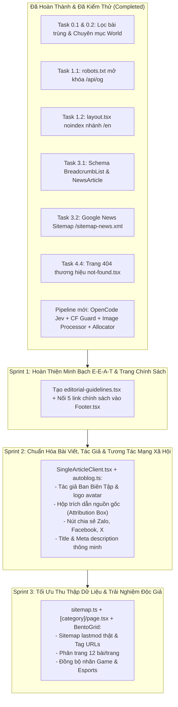

# 📋 KẾ HOẠCH NÂNG CẤP TOÀN DIỆN HỆ THỐNG NEWS STUDIO (BẢN TINH GỌN & TỐI ƯU HÓA)

> **Mục tiêu**: Hợp nhất và tinh gọn các hạng mục kỹ thuật, SEO, E-E-A-T và UX. Loại bỏ trùng lặp giữa các task cùng file tác động, tích hợp đồng bộ các pipeline mới (Content Allocator, Image Processor, OpenCode Jev, CF Sentinel) nhằm tối ưu chỉ số tín nhiệm của Google và trải nghiệm người dùng.
> **Thời gian cập nhật**: 2026-10-15
> **Trạng thái tổng thể**: Đã hoàn thành 55% khối lượng công việc — Sẵn sàng thực thi 3 Sprint gom nhóm.

---

## 🟢 PHẦN 1: CÁC ĐẦU VIỆC ĐÃ HOÀN TẤT & ĐƯỢC KIỂM CHỨNG (DONE)

- [x] **Task 0.1: Triage và loại bỏ bài trùng lặp**: Đã xóa 6 bài trùng, giữ lại canonical, kiểm định thuật toán `isSameStory`.
- [x] **Task 0.2: Khởi tạo chuyên mục `world`**: Đã cấu trúc 10 chuyên mục chuẩn, dời bài quốc tế sang `world`, tạo `WorldTemplate.tsx`.
- [x] **Task 1.1: Cho phép bot mạng xã hội lấy ảnh OpenGraph**: `frontend/src/app/robots.ts` đã có `allow: ['/', '/api/og']`.
- [x] **Task 1.2: Chặn index nhánh `/en` chưa dịch**: `frontend/src/app/[locale]/layout.tsx` đã cấu hình `robots: locale === 'en' ? { index: false, follow: true } : { index: true, follow: true }`.
- [x] **Task 3.1: Bổ sung Schema BreadcrumbList**: `frontend/src/app/[locale]/(site)/[category]/[slug]/page.tsx` đã nhúng đầy đủ `BreadcrumbList` song song với `NewsArticle`.
- [x] **Task 3.2: Xây dựng Google News Sitemap**: Đã triển khai route chuẩn `frontend/src/app/sitemap-news.xml/route.ts` lọc tin tức trong vòng 48h.
- [x] **Task 4.4: Trang báo lỗi 404 thương hiệu**: `frontend/src/app/[locale]/not-found.tsx` đã hoạt động với giao diện News Studio chuẩn.
- [x] **Pipeline Nâng Cấp Hệ Thống (Mới)**:
  - *CF AI Quota Guard* (`cf-ai.ts`): Giám sát hạn mức 10k Neuron/ngày, ngắt an toàn tại 7,500.
  - *OpenCode Model Jev* (`opencode.ts`): Đánh giá giá trị tin tức (Score ≥ 7.0) & trích xuất sự thật.
  - *Image Processing Engine* (`image-processor.ts`): Bể 50+ ảnh tuyển chọn, hash slug bất biến, chặn tracking pixel.
  - *Dynamic Content Allocator* (`content-allocator.ts`): Trọng số tin theo khung giờ & Bento Grid đa dạng.
  - *Syndication Feeds* (`/api/feed` & `syndication.ts`): Hỗ trợ RSS 2.0 và JSON Feed v1.1.

---

## 🚀 PHẦN 2: 3 SPRINT GOM NHÓM THỰC THI (CONSOLIDATED SPRINTS)

Thay vì thực hiện 14 task lẻ tẻ gây xung đột mã nguồn và chỉnh sửa trùng lặp cùng một file nhiều lần, toàn bộ các hạng mục còn lại được gom thành **3 Sprint thực thi thống nhất**:

### 🎯 SPRINT 1: HOÀN THIỆN MINH BẠCH E-E-A-T & ĐIỀU HƯỚNG PHÁP LÝ
*(Gộp chung Task 2.1 và Task 2.2 — Cùng chung hệ thống trang thông tin và footer)*

- **Mục tiêu**: Nâng cao độ uy tín (Trust) của website theo hướng dẫn Google Search Quality Rater & Google News Policy.
- **Files tác động**:
  - `frontend/src/app/[locale]/(site)/editorial-guidelines/page.tsx` *(Tạo mới)*: Quy chuẩn biên tập, kiểm chứng nguồn tin và tuyên bố minh bạch ứng dụng AI (AI Transparency Disclosure).
  - `frontend/src/components/ui/Footer.tsx`: Đồng bộ liên kết trỏ tới toàn bộ 5 trang chính sách thật (`/about`, `/editorial-guidelines`, `/terms`, `/privacy`, `/contact`).
- **DoD (Tiêu chí nghiệm thu)**:
  - Truy cập `/vi/editorial-guidelines` hiển thị đầy đủ tiêu chuẩn biên tập và tuyên bố AI.
  - Tất cả liên kết tại mục "Thông tin" ở Footer dẫn đến trang nội dung thật, không có liên kết hỏng hay trỏ về `/`.

---

### 🎯 SPRINT 2: CHUẨN HÓA CHI TIẾT BÀI VIẾT, DANH TÍNH TÁC GIẢ & TƯƠNG TÁC XÃ HỘI
*(Gộp chung Task 2.3, Task 2.4, Task 3.3 và Task 4.2 — Tất cả đều thuộc luồng hiển thị và biên tập bài viết)*

- **Mục tiêu**: Chuẩn hóa định danh biên tập viên chuyên nghiệp, minh bạch nguồn gốc tin tức quốc tế, mở rộng kênh lan tỏa mạng xã hội (Zalo/Facebook/X) và bảo toàn tính toàn vẹn của thẻ tiêu đề/mô tả.
- **Files tác động**:
  - `frontend/src/app/[locale]/(site)/[category]/[slug]/SingleArticleClient.tsx`:
    - Thay thế hoàn toàn "AI Autobot" và avatar pravatar bằng `"Ban Biên Tập News Studio"` kèm logo thương hiệu `/icon-192x192.png`.
    - Thêm hộp **Attribution Box** ở chân bài: *"Theo [Nguồn tin gốc] (Xem bài gốc ↗)"* kèm thuộc tính `rel="nofollow noopener"`.
    - Bổ sung nút chia sẻ **Zalo** (`https://zalo.me/share?url=...`), **Facebook** (`https://www.facebook.com/sharer/sharer.php?u=...`), nâng cấp icon **X**.
  - `frontend/scripts/autoblog.ts`:
    - Gán mặc định `author: "Ban Biên Tập News Studio"`, `authorRole: "Ban Biên Tập Tin Tức"`.
    - Lưu trường `sourceUrl` và `sourceName` vào frontmatter khi cào và tổng hợp bài viết.
  - `frontend/src/app/[locale]/(site)/[category]/[slug]/page.tsx`:
    - Kiểm soát độ dài tiêu đề hiển thị và ngắt câu meta description thông minh qua `smartTruncate`.
- **DoD (Tiêu chí nghiệm thu)**:
  - Khối tác giả hiển thị chuyên nghiệp, không còn dấu vết placeholder hay avatar bên thứ ba.
  - Hộp trích dẫn nguồn hiển thị chuẩn xác khi có metadata nguồn.
  - Chia sẻ 1-click mượt mà trên Zalo, Facebook và X.

---

### 🎯 SPRINT 3: TỐI ƯU CRAWL BUDGET, PHÂN TRANG CHUYÊN MỤC & ĐỒNG BỘ GIAO DIỆN
*(Gộp chung Task 1.3, Task 4.1 và Task 4.3 — Thuộc luồng khám phá dữ liệu, sitemap và danh mục)*

- **Mục tiêu**: Cung cấp tín hiệu crawl chính xác cho Googlebot, giảm tải tải trọng render trang chuyên mục có nhiều bài viết và đồng bộ thương hiệu chuyên mục trên toàn bộ giao diện.
- **Files tác động**:
  - `frontend/src/app/sitemap.ts`:
    - Gán `lastModified` của từng chuyên mục theo ngày xuất bản của bài viết mới nhất trong chuyên mục đó.
    - Gọi `getAllTagsUnified()` để sinh danh sách các route `/vi/tag/[tag]` vào sitemap với `priority: 0.5`.
  - `frontend/src/app/[locale]/(site)/[category]/page.tsx` & các Template:
    - Triển khai phân trang 12 bài/trang, hỗ trợ query param `?page=X`.
    - Render khối phân trang số kèm các thẻ `<Link href="?page=X">` chuẩn SEO.
  - `frontend/src/components/ui/BentoGrid.tsx`, `CategorySections.tsx`, `Footer.tsx`:
    - Thống nhất đồng bộ nhãn danh mục `game` thành **"Game & Esports"**.
- **DoD (Tiêu chí nghiệm thu)**:
  - `/sitemap.xml` có đầy đủ tag URL và thời gian cập nhật thực tế.
  - Các chuyên mục có hơn 12 bài hiển thị bộ chuyển trang phân trang mượt mà.
  - Nhãn "Game & Esports" đồng nhất từ Header, BentoGrid đến Footer.

---

## 📊 MA TRẬN TIẾN ĐỘ THỰC THI GOM NHÓM

| Sprint | Phạm Vi Gom Nhóm | Các Task Gốc | Trạng Thái | File Trọng Tâm |
| :--- | :--- | :--- | :---: | :--- |
| **Đã Xong** | Hạ tầng, Dead links, AI Pipelines | Task 0.1, 0.2, 1.1, 1.2, 3.1, 3.2, 4.4 + Pipelines mới | 🟢 ĐÃ XONG | `robots.ts`, `layout.tsx`, `not-found.tsx`, `sitemap-news.xml` |
| **Sprint 1** | Minh bạch E-E-A-T & Footer Links | Task 2.1, 2.2 | 🟡 SẴN SÀNG | `editorial-guidelines/page.tsx`, `Footer.tsx` |
| **Sprint 2** | Bài viết, Tác giả, Nguồn & Social | Task 2.3, 2.4, 3.3, 4.2 | 🟡 TIẾP THEO | `SingleArticleClient.tsx`, `autoblog.ts`, `[slug]/page.tsx` |
| **Sprint 3** | Sitemap Tags, Phân trang & UI | Task 1.3, 4.1, 4.3 | 🟡 TIẾP THEO | `sitemap.ts`, `[category]/page.tsx`, `BentoGrid.tsx` |
